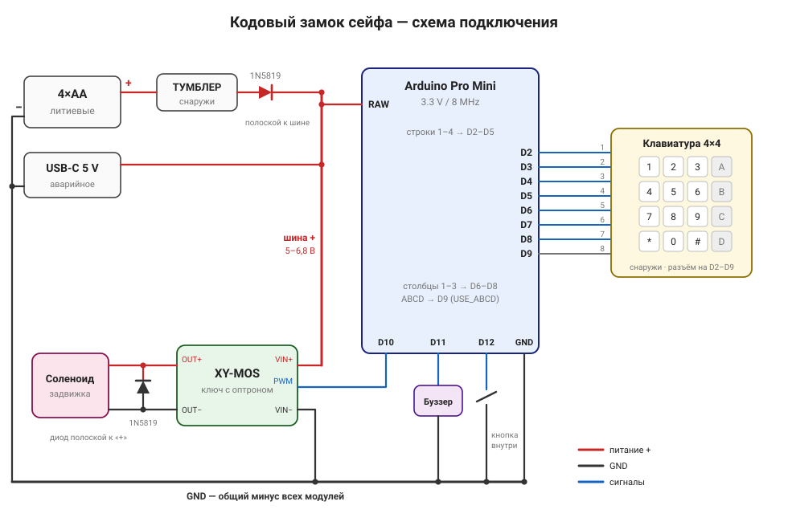

# safe-lock — кодовый замок сейфа на Arduino Pro Mini

Электронный кодовый замок для сейфа взамен сгоревшей заводской платы. Механика остаётся родной: подпружиненная задвижка-электромагнит блокирует ригель, механический аварийный ключ работает как раньше. Новая электроника собирается из готовых модулей, **паять ничего не нужно**.



## Возможности

- **Ноль потребления в простое.** Питание 4×AA включается наружным тумблером. Когда он выключен, цепь разорвана механически.
- **Аварийное питание через USB-C**, если сели батарейки.
- **Код от 4 до 8 символов** с клавиатуры 4×4: цифры, по желанию ещё A–D. Заводской код `0000#`.
- **Защита от перебора.** После 3 ошибок блокировка на 5 минут, потом 1 попытка и снова 5 минут. Выключение питания блокировку не снимает, а начинает отсчёт заново.
- **Надёжное хранение.** Код и состояние хранятся в EEPROM в 3 копиях с номером записи и CRC16. Обрыв питания в любой момент оставляет либо старое, либо новое значение. Проверено тестом: 51 440 проверок, 0 ошибок.
- **Экономное открытие с индикатором батарей.** Соленоид получает 1 с полный ток, затем ШИМ плавно спадает до 50 %. В конце каждой секунды звучит короткий тон (высокий, средний, низкий), по нему слышно, сколько продержалась задвижка. Если она отпадает раньше последнего тона, батарейки пора менять.
- **Звуковые сигналы** для всех событий и напоминание выключить тумблер: писк раз в 30 с, между писками контроллер спит.
- **Отказ в сторону «закрыто».** При любой неисправности соленоид обесточен.

## Быстрый старт

1. Соберите схему: [docs/wiring.md](docs/wiring.md). Список деталей — [docs/bom.md](docs/bom.md).
2. Прошейте Pro Mini: [docs/firmware.md](docs/firmware.md). Есть готовый файл [firmware/prebuilt/](firmware/prebuilt/), его можно залить без Arduino IDE.
3. Включите тумблер: должны прозвучать два писка «готов». Введите `0000#`, соленоид должен сработать.
4. Смените код на свой: [docs/usage.md](docs/usage.md#сменить-код).
5. Пройдите чек-лист первого запуска: [docs/commissioning.md](docs/commissioning.md).

## Документация

| Раздел | Содержание |
|---|---|
| [Комплектующие](docs/bom.md) | что купить и зачем |
| [Подключение](docs/wiring.md) | схема, распиновка, питание, сборка без пайки |
| [Прошивка](docs/firmware.md) | Arduino IDE, загрузка, готовый .hex, фьюзы, watchdog, частые ошибки IDE |
| [Настройки](docs/configuration.md) | все параметры прошивки |
| [Эксплуатация](docs/usage.md) | открыть, сменить код, сброс, блокировка, сигналы буззера |
| [Хранение данных](docs/storage.md) | как устроена защита от обрыва питания и тест на ПК |
| [Первый запуск](docs/commissioning.md) | чек-лист проверки после сборки |
| [Неисправности](docs/troubleshooting.md) | симптомы и что делать |
| [Решения по конструкции](docs/design-notes.md) | почему сделано именно так |
| [История изменений](CHANGELOG.md) | версии прошивки |

## Структура репозитория

```
safe-lock/
├── firmware/
│   ├── safe_lock/safe_lock.ino   прошивка (скетч Arduino)
│   └── prebuilt/                 готовая прошивка .hex с настройками по умолчанию
├── docs/                         документация и схема
├── test/                         тест модуля хранения на ПК
└── .github/workflows/ci.yml      автосборка прошивки и тест на GitHub
```

## Коротко о главном

| | |
|---|---|
| Контроллер | Arduino Pro Mini **3.3 V / 8 MHz** (ATmega328P) |
| Клавиатура | 4×4, разъём прямо на D2–D9 |
| Соленоид | через модуль XY-MOS, ШИМ на D10 |
| Буззер | D11 |
| Кнопка программирования | D12, внутри сейфа |
| Питание | 4×AA литиевые через тумблер и диод 1N5819, аварийно USB-C 5 В |

## Безопасность

- Сразу после сборки **смените заводской код** `0000`.
- **Механический ключ не храните в сейфе**: это единственный способ открыть сейф, если электроника откажет.
- Код прошивки открыт. Защита держится не на секретности прошивки, а на коде и блокировке после ошибок: 3 попытки, затем по одной раз в 5 минут.
- Проект любительский и поставляется «как есть» (см. [LICENSE](LICENSE)). Перед тем как закрывать в сейфе важные вещи, проверьте замок по [чек-листу](docs/commissioning.md).

## Лицензия

[MIT](LICENSE)
